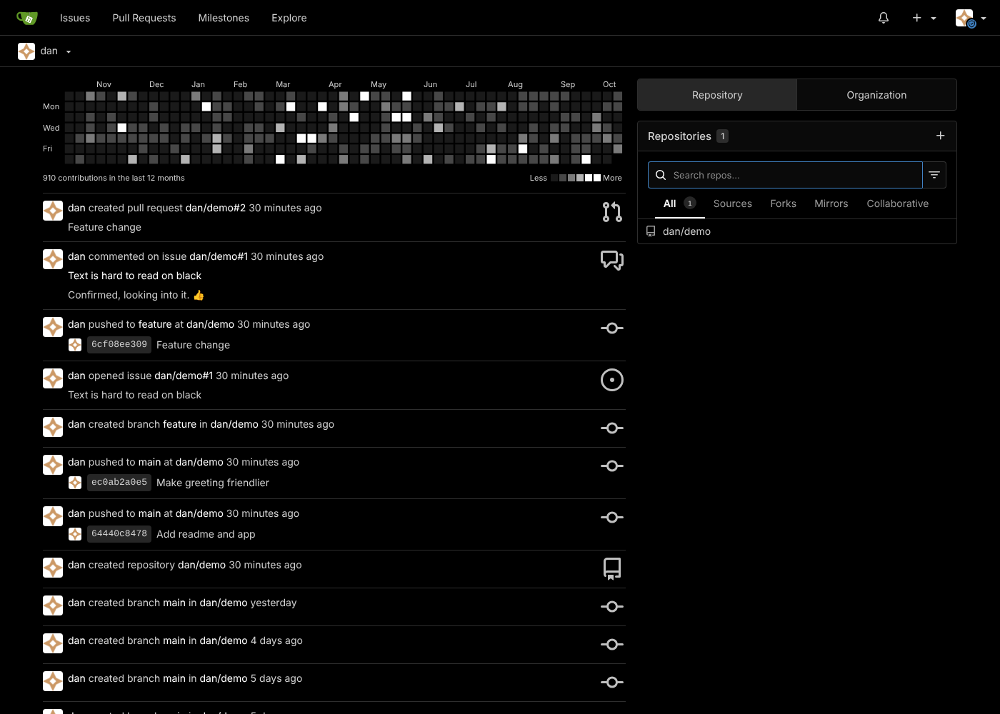
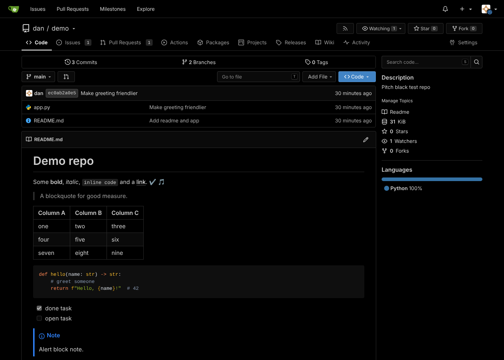
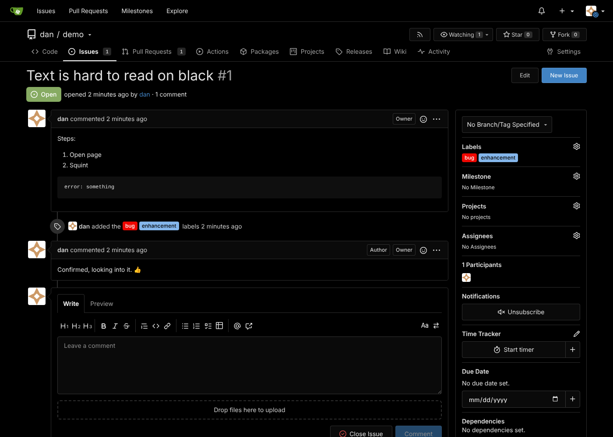
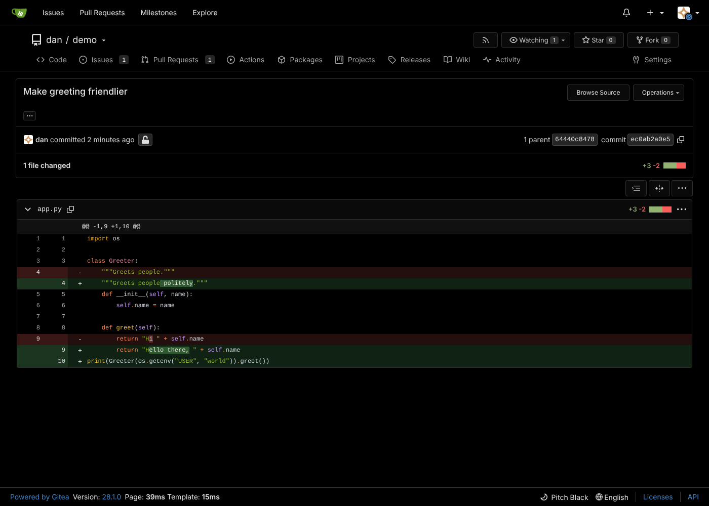

# Gitea-Pitch-Black

A pitch black theme for [Gitea](https://github.com/go-gitea/gitea): as black as possible without giving up readability or making any control hard to find.

Built from Gitea's stock **Dark** theme (`web_src/css/themes/theme-gitea-dark.css` at tag `v28.1.0`).

| Gitea version | Status |
|---|---|
| v28.x | Supported (primary target, tested on v28.1.0) |
| v1.27.x | Supported (compat variables and emoji selectors included) |
| v1.19 – v1.26 | Not tested: use the 1.25.X release instead |
| v1.14 – v1.18 | Use the legacy `theme-pitchblack.less` |

## Files

| File | What it is |
|---|---|
| `theme-pitchblack.css` | Minified, no comments. This is the one to install. |
| `theme-pitchblack-max.css` | Same theme, human readable, with comments explaining every section. Use it to tweak colors, then re-minify (or install it as-is). |
| `theme-pitchblack.less` | Legacy theme for Gitea 1.14 – 1.18. |

## Install

1. Copy `theme-pitchblack.css` to `$GITEA_CUSTOM/public/assets/css/`
   (for example `/var/lib/gitea/custom/public/assets/css/` or `/data/gitea/public/assets/css/` in Docker).
2. If your `app.ini` sets `[ui] THEMES`, add `pitchblack` to the list. To make it the default, also set `DEFAULT_THEME`:

   ```ini
   [ui]
   THEMES = gitea-auto, gitea-light, gitea-dark, pitchblack
   DEFAULT_THEME = pitchblack
   ```

   If `THEMES` is not set, Gitea lists every theme it finds automatically.
3. Restart Gitea and choose **Pitch Black** in *Settings → Appearance*.

Install only one of the two `.css` files. Gitea names themes after the file name, so installing both gives you two entries (`pitchblack` and `pitchblack-max`) with the same display name.

## Why the old version stopped working

Since v1.26, Gitea bundles its built-in themes with hashed file names, so a custom theme can no longer `@import` the stock dark theme. This version is fully self-contained: it defines every `--color-*` variable Gitea uses and imports nothing.

## Design notes

- Page, boxes, nav bars and code view are `#000000`. Box headers, inputs, menus and buttons sit one step off black (`#0a0a0a`) so they're still distinguishable.
- Layout comes from visible neutral grey borders (`#2e2e2e`) rather than grey panels.
- Greyscale links: links are white, body text is light grey (`#d0d0d0`), so links are the brightest text on the page. Inline links in rendered markdown also get a faint grey underline. Primary buttons, active tabs and focus rings stay blue.
- The contribution heatmap goes from dark grey (least activity) to white (most).
- The dimmest text color (`#8c8c8c`) still has about 6.4:1 contrast on black.
- Link and heatmap colors are `--pb-*` variables near the bottom of the `:root` block in `theme-pitchblack-max.css`, so they're easy to retune.
- Diff, status, label and syntax colors keep their stock hues, with backgrounds pushed darker, so meaning is never lost.
- Neutral (not blue-tinted) greys throughout, plus dark scrollbars.

## Screenshots (Gitea v28.1.0)





